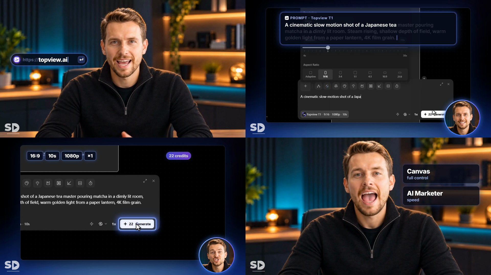

# Topview tutorial edit: Malva AI style

A 72-second YouTube tutorial edit built for a freelance editor test. The test asked for a talking head plus
screen recordings of an AI tool (Topview), edited in the style of the
[Malva AI](https://www.youtube.com/@malvaAI) channel: zooms, text pop-ups, a facecam bubble, logo animation,
sound effects and music.



**Watch:** [`deliverables/Topview_Malva_Test_SD_v2.mp4`](deliverables/Topview_Malva_Test_SD_v2.mp4)
(1920×1080, 30 fps, 1:12, −14 LUFS)

## What's in the edit

| Time | Line | Picture |
|---|---|---|
| 0:00 | Cold open | The Topview T1 clip generated in the video, with the Topview logo resolving over it |
| 0:01 | "Open topview.ai…" | Presenter full frame; an address bar morphs open from the Topview icon, types `topview.ai` with the voice and presses Enter |
| 0:03 | Canvas → new node → Text to Video → Topview T1 | Screen card on a navy/blue-glow stage, facecam bubble, zooms and glow boxes on every click |
| 0:18 | The prompt | A prompt card that types word by word in sync with the voice, over the real typing in the tool |
| 0:31 | 16:9 · 10 s · 1080p · ×1 → Generate | One zoom per setting; settings chips stack up as each is said; "22 credits" on Generate |
| 0:40 | "While that renders…" | Presenter punch-in with a rendering pill |
| 0:42 | AI Marketer → URL to Video | Product link, Start creating, then the ad Topview generated, full frame |
| 0:51 | Back in Canvas | The finished T1 clip as a beauty shot, then preview, download and regenerate |
| 1:01 | The summary | Presenter with three cards (Canvas, AI Marketer, 12+ models) and a Topview logo end card |

All results shown were generated in the test account (one Topview T1 clip, one AI Marketer ad).

## How it was made

1. **Talking head.** `tools/th_cut.py` tightens every pause longer than 0.28 s to about 0.2 s (77 s → 69 s) and maps the
   transcript's word times onto the new timeline.
2. **Screen recording.** A Playwright Chromium window drives Topview with smooth, eased cursor moves
   (`tools/pw_lib.inc.js`, `tools/steps_*.js`), while the Cap CLI records the screen. Cap leaves the cursor out of the
   video, so the scripts draw their own cursor and a click ripple in the page.
3. **Frame-true clicks.** Cap writes variable-frame-rate video, which makes seeks drift. Every recording is converted to
   constant 60 fps first. `tools/detect_clicks.py` then finds each click from the ripple (a violet ring that grows from
   14 px to 44 px in 0.35 s). Clicks it can't see (on yellow, white or purple buttons) were measured from
   20 fps crop strips (`tools/clipstrip.py`).
4. **The cut.** `tools/build.py` anchors every screen segment on its measured click, so each click lands on the word
   that names it ("Canvas", "plus icon", "16", "1080p", "Generate"…). The click sound sits one frame after the picture.
   Topview's canvas page hides the injected cursor, so the comp adds a matching cursor there that glides between the
   measured click points.
5. **The comp.** [HyperFrames](https://hyperframes.heygen.com) (HTML rendered to video). `film/index.html` is generated
   by `tools/build.py`: the screen card with GSAP zooms, glow boxes, pop-ups, the facecam bubble, the address bar, the
   prompt card, the summary cards and the logo.
6. **Sound.** Voice, a music bed ducked under the voice, a real mouse press on every click, one dry UI family for
   pop-ups, short swishes (≤ 0.45 s) only on scene changes, a deep drum hit on the end card. Mixed and loudness-normalised
   to −14 LUFS in ffmpeg (`tools/build.py audio`).
7. **Checks.** `tools/verify_sync.py` and before/after comp snapshots at every click; the final file's click sounds were
   measured against their planned frames.

More detail: [`docs/PRODUCTION.md`](docs/PRODUCTION.md) (pipeline, gotchas) and [`docs/EDIT_PLAN.md`](docs/EDIT_PLAN.md)
(the original plan and style notes).

## Repository layout

```
deliverables/   final master (Git LFS) and a preview frame
docs/           production notes, the edit plan, the preview collage
film/           HyperFrames project; index.html is generated by tools/build.py
tools/          talking-head cut, recording scripts, click detection, the build, sync checks
BRIEF.md        the test brief (summary)
```

Not in the repo: the client's talking-head footage and logos, the screen recordings, the generated clips, the
reference videos and every intermediate (`raw/`, `rec/`, `build/`, `ref/`, `renders/`, `film/assets/`). The tools
expect them at those paths.

## Rebuilding

Needs Python 3.12 (numpy, opencv-python, Pillow, faster-whisper), ffmpeg, Node 20+ and the HyperFrames CLI.

```bash
python -I tools/th_cut.py                  # build/th_cut.mp4, vo.wav, words_cut.json
python -I tools/detect_clicks.py           # build/clicks.json from rec/*_cfr.mp4
python -I tools/build.py                   # assets, screen track, audio mix, film/index.html
cd film && npx hyperframes check && npx hyperframes render --quality delivery --fps 30 -o ../renders/out.mp4
```

Measure the render's loudness afterwards: if the HyperFrames render comes out quieter than `film/assets/mix.wav`, remux
the mix (`ffmpeg -i out.mp4 -i film/assets/mix.wav -map 0:v -map 1:a -c:v copy -c:a aac -b:a 320k final.mp4`).

## Credits

- Topview product, logos and UI belong to Topview. The talking-head footage and script were provided by the client for
  the test.
- Sound effects: [Mixkit](https://mixkit.co/license/#sfxFree) (free licence) and [uisfx](https://www.npmjs.com/package/uisfx) (CC0).
  Music bed: AI-generated for an earlier project.
- Edit, motion design and tooling: Subham Dey.
